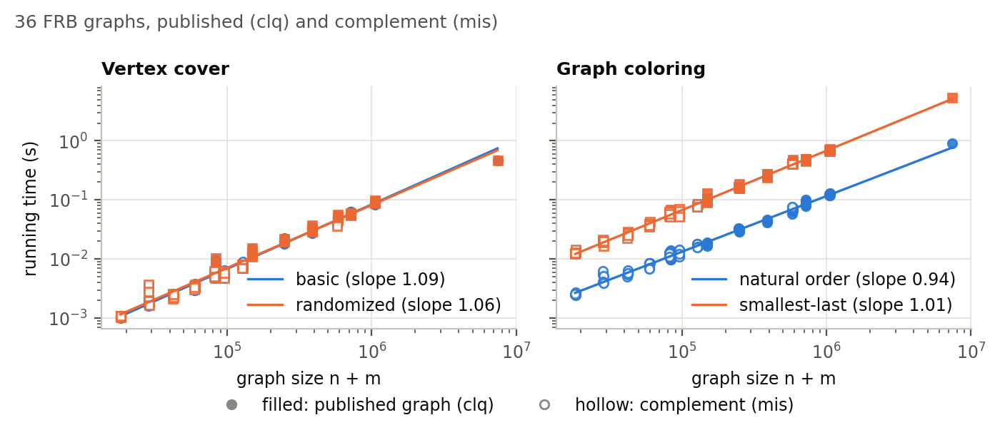
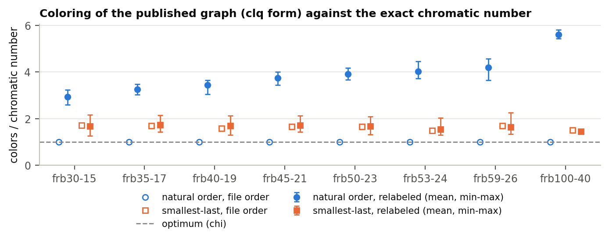

# Vertex Cover and Graph Coloring Heuristics — COSC 520 Assignment 3

How good are the simplest heuristics for two NP-hard graph problems, measured
against the **exact** optimum? This project implements four algorithms from
scratch in Python, analyses their time and space complexity, and benchmarks
them on all 36 BHOSLIB/FRB graphs (up to 7.4 million edges) and on random
graphs with up to 10⁶ vertices.

| Problem | Algorithm | Function | Guarantee |
|---|---|---|---|
| Vertex cover | **Basic**: both endpoints of each uncovered edge | `basic_vertex_cover` | \|C\| ≤ 2·OPT |
| Vertex cover | **Randomized** [Pitt 1985]: one random endpoint | `randomized_vertex_cover` | E\|C\| ≤ 2·OPT |
| Coloring | **Greedy, natural order** 0, 1, …, n−1 | `natural_coloring` | ≤ Δ + 1 colors |
| Coloring | **Greedy, smallest-last order** [Matula & Beck 1983] | `smallest_last_coloring` | ≤ degeneracy + 1 colors |

All four run in Θ(n + m) time with Θ(n) extra space. No graph library is used
(a unit test enforces this), and every algorithm is iterative.

**Read the report: [report/report.pdf](report/report.pdf)** (ACM Small format).

## Quick start

```bash
git clone https://github.com/ahmedelgazwy/Advanced_DS_assignment_3.git
cd Advanced_DS_assignment_3
python -m venv .venv                       # Windows: py -3.10 -m venv .venv
source .venv/bin/activate                  # Windows: .venv\Scripts\activate
pip install -r requirements.txt

python -m pytest                           # 121 tests, about 15 s
python demo.py                             # live comparison, about 3 s
python -m scripts.download_dataset         # the 36 FRB graphs, about 51 MB (optional)
python -m scripts.run_benchmarks --quick   # small benchmark, about 1 minute
python -m scripts.plot_results --results results/quick
```

The tests and the demo do not need the dataset. Without it, the tests that
read real FRB files are skipped, and the demo uses a generated graph with the
same structure. If something fails, see [Troubleshooting](#troubleshooting).

## Repository layout

```
.
├── graph_heuristics/       # the library
│   ├── graph.py            #   Graph: edge list + CSR adjacency in flat arrays, complement()
│   ├── vertex_cover.py     #   basic_vertex_cover, randomized_vertex_cover, is_vertex_cover
│   ├── coloring.py         #   greedy_coloring, natural_order, smallest_last_order, checks
│   ├── generators.py       #   random graphs, planted FRB-like graphs, worst-case families,
│   │                       #   random relabeling
│   ├── graph_io.py         #   Matrix Market and DIMACS readers (plain, .gz, .zip)
│   ├── datasets.py         #   the FRB catalogue, exact optima, loading
│   └── experiment.py       #   timing, memory, slope fit, tables
├── demo.py                 # live comparison of the four algorithms
├── scripts/
│   ├── download_dataset.py # CLI: downloads and verifies the FRB graphs
│   ├── run_benchmarks.py   # CLI: experiments E1–E5 -> results/*.csv
│   └── plot_results.py     # CLI: figures, fitted slopes, results/summary.md
├── tests/                  # pytest suite (121 tests)
├── results/                # benchmark CSVs, figures/, summary.md, run log (committed)
├── data/                   # README.md and manifest.json (the graphs are downloaded)
├── report/                 # ACM-format LaTeX report and the compiled report.pdf
├── docs/
│   ├── plan.md             # the plan, with the decisions D1–D5
│   ├── theory.md           # complexity analysis, proofs, hypotheses H1–H8, references
│   ├── author_tasks.md     # the parts written by the author
│   └── review_log.md       # the author's review decisions, phase by phase
├── requirements.txt        # pinned dependencies
└── pyproject.toml          # pytest configuration
```

## Setup

Requires **Python 3.10 or newer**. Run every command from the repository root.

**Windows (PowerShell)**
```powershell
py -3.10 -m venv .venv
.venv\Scripts\Activate.ps1      # cmd.exe: .venv\Scripts\activate.bat
pip install -r requirements.txt
```

**macOS / Linux**
```bash
python3 -m venv .venv
source .venv/bin/activate
pip install -r requirements.txt
```

The package itself needs no installation. matplotlib and numpy are used only
by `scripts/plot_results.py`; the algorithms use the standard library alone.

## Running the tests

```bash
python -m pytest
```

The suite takes about 15 seconds. The slow, obviously correct oracles in
`tests/reference.py` back the tests: the lecture pseudo-code run literally, and
brute-force optima for small graphs.

| File | Tests | What it checks |
|---|---|---|
| `tests/test_vertex_cover.py` | 27 | **Validity** on random graphs.<br>**Basic:** identical to the lecture loop run literally; forms a maximal matching; ≤ 2·OPT against brute force; tight examples.<br>**Randomized:** reproducible seeds; a fair coin; expected ≤ 2·OPT; optimal on a perfect matching. |
| `tests/test_coloring.py` | 30 | **Greedy:** identical to a literal "lowest legal color" loop; proper; ≤ Δ + 1 and ≥ χ.<br>**Smallest-last:** each removal has minimum degree; the degeneracy matches brute force; its largest back degree is the minimum over all n! orders; ≤ d + 1 colors; trees get 2.<br>**Adversarial cases:** the crown graph and the binomial tree. |
| `tests/test_author_cases.py` | 5 | hand-worked cases written by the author |
| `tests/test_graph.py`, `test_graph_io.py` | 22 | CSR correctness, repeated edges, validation, complement; `.mtx`/DIMACS readers in plain, gzip and zip form |
| `tests/test_generators.py`, `test_datasets.py` | 17 | generators and relabeling; the planted optima by brute force; the FRB catalogue; the real files and manifest when downloaded |
| `tests/test_experiment.py`, `test_scripts.py`, `test_demo.py` | 11 | timing and memory helpers, slope fit; the benchmark, plots and demo end to end |
| `tests/test_no_libraries.py` | 9 | no graph or numeric library is imported by the package or the demo |

## Demo

```bash
python demo.py                  # about 3 s
python demo.py --instance frb40-19-1 --seeds 50
```

The demo has three parts:

1. **How they work:** a small graph, both covers, both colorings, and the smallest-last removal sequence with each vertex's degree at removal.
2. **Where they differ:**
    - vertex cover: the perfect matching (basic = 2·OPT, randomized = OPT), K₂₀,₂₀ and the star;
    - coloring: the crown graph (natural order uses 100 colors, smallest-last 2) and the binomial tree B₁₂ (13 colors against 2).
3. **A real benchmark graph** (`frb30-15-1`) against its exact optima, in the file's numbering and on randomly relabeled copies.

Part 3 of a run (Intel i7-11800H, Python 3.10):

```
Vertex cover of the complement (n = 450, m = 17,827); exact minimum = 420

algorithm   numbering             cover size       size / OPT  time (ms)
----------  --------------------  ---------------  ----------  ---------
basic       file order                        450       1.071        0.9
basic       relabeled             444.4 (444-446)       1.058
randomized  file order, 30 seeds  448.9 (448-449)       1.069        1.1
randomized  relabeled             440.6 (438-442)       1.049
Any cover is at most n / OPT = 1.071 times the optimum here.

Coloring the graph (n = 450, m = 83,198); exact chromatic number = 30

algorithm      numbering   colors        colors / chi  time (ms)
-------------  ----------  ------------  ------------  ---------
natural        file order            30         1.000       11.2
natural        relabeled   88.4 (85-93)         2.947
smallest-last  file order            41         1.367       55.9
smallest-last  relabeled   49.2 (46-54)         1.640
```

## Benchmarks

```bash
python -m scripts.download_dataset         # once: the 36 FRB graphs
python -m scripts.run_benchmarks --quick   # setup check: about 1 minute -> results/quick/
python -m scripts.plot_results --results results/quick

python -m scripts.run_benchmarks           # full run: about 15 minutes -> results/
python -m scripts.plot_results
```

| Experiment | Graphs | Measured |
|---|---|---|
| E1 runtime | 36 FRB graphs × {published `clq`, complement `mis`} | time of every algorithm, and smallest-last split into ordering and coloring |
| E2 quality | the same | cover size / OPT and colors / χ (exact optima), in file order and on 5 randomly relabeled copies; randomized cover over 30 seeds |
| E3 scaling | G(n, 5n), n = 10³ … 10⁶ | time against n + m; log-log slope |
| E4 memory | G(n, 5n) and two FRB graphs | `tracemalloc` peak per algorithm |
| E5 worst cases | perfect matching, K₁₀₀,₁₀₀, star, K₅₀, crown graph, binomial tree | cover sizes and color counts against the optimum |

Times are medians of 5 runs (3 for graphs with more than 2 million edges),
with the garbage collector paused and graph loading excluded.

### Results

Full run on an Intel i7-11800H (16 GiB RAM, Windows 11, Python 3.10.2), taking
15 minutes. The raw data is in [results/](results/), every table is in
[results/summary.md](results/summary.md), and the figures are in
[results/figures/](results/figures/) as PNG and PDF.



| Per FRB family (mean) | frb30-15 | frb50-23 | frb59-26 | frb100-40 |
|---|---|---|---|---|
| Edges (published `clq` form) | 83,198 | 580,218 | 1,049,452 | 7,425,226 |
| Basic / randomized VC (ms) | 7.5 / 7.7 | 50.4 / 49.8 | 87.9 / 92.1 | 463 / 464 |
| Natural / smallest-last coloring (ms) | 10.7 / 60.5 | 68.5 / 431 | 124 / 698 | 902 / 5,420 |
| Cover / OPT, basic → randomized (relabeled) | 1.058 → **1.048** | 1.038 → **1.031** | 1.034 → **1.027** | 1.022 → **1.018** |
| Colors / χ, natural (file order) | 1.00 | 1.00 | 1.00 | 1.00 |
| Colors / χ, natural → smallest-last (relabeled) | 2.93 → **1.67** | 3.91 → **1.68** | 4.20 → **1.64** | 5.60 → **1.45** |

- **All four algorithms are linear.**
    - The log-log slopes of time against n + m are 0.94–1.09 on FRB and 1.01–1.07 on G(n, 5n) up to 10⁶ vertices.
    - Extra memory is a constant 31–52 bytes per vertex, whatever the number of edges.
- **The randomized vertex cover is the better default.**
    - It costs the same as the basic one, and finds smaller covers in every family.
    - It is optimal on a perfect matching, where the basic algorithm takes exactly 2·OPT.
- **Smallest-last costs 5–6× the time of natural coloring, but uses 1.7–3.9× fewer colors** on relabeled graphs. Its ordering pass costs about 4.5 greedy passes per edge.
- **The FRB files leak the planted solution to the natural order.** Their vertices are numbered group by group, and each group is an independent set. So natural greedy coloring in file order uses exactly χ colors on all 36 graphs, and 2.9–5.6 χ once the graph is relabeled. Quality is therefore reported on randomly relabeled copies too.



## Usage

```python
from graph_heuristics.graph import Graph
from graph_heuristics.vertex_cover import basic_vertex_cover, randomized_vertex_cover
from graph_heuristics.coloring import natural_coloring, smallest_last_coloring, color_count

graph = Graph.from_edges(5, [(0, 1), (1, 2), (2, 0), (2, 3), (3, 4)])
basic_vertex_cover(graph)                 # [0, 1, 2, 3]
randomized_vertex_cover(graph, seed=1)    # one random endpoint per uncovered edge
colors = smallest_last_coloring(graph)    # colors[v] for every vertex
color_count(colors)                       # 3

from graph_heuristics.datasets import parse_instance, load_frb
instance = parse_instance("frb30-15-1")
clq = load_frb(instance, "clq")           # needs python -m scripts.download_dataset
mis = load_frb(instance, "mis")           # the complement
instance.chromatic_number, instance.min_vertex_cover   # (30, 420)
```

## Dataset

The 36 FRB graphs of the BHOSLIB benchmark, from Network Repository:
https://networkrepository.com/bhoslib.php. Download and verify them with
`python -m scripts.download_dataset` (about 51 MB, SHA-256 checksums in
[data/manifest.json](data/manifest.json)). [data/README.md](data/README.md)
describes the format, the families, and why the chromatic number of each graph
and the minimum vertex cover of its complement are known exactly.

## Report and theory

- **[report/report.pdf](report/report.pdf)**: the report. Its LaTeX source is in [report/](report/), and [report/README.md](report/README.md) explains how to compile it on Overleaf.
- **[docs/theory.md](docs/theory.md)**: the full complexity analysis behind the report. It covers the proofs of both vertex cover bounds, the degeneracy guarantee of smallest-last, the bucket-queue analysis, the memory model and hypotheses H1–H8.

## AI usage and authorship

This project was developed with the help of an AI coding assistant (Claude
Code, Anthropic), as allowed by the course policy with disclosure.

- **The author (Ahmed Elgazwy)**
  - wrote the bodies of `basic_vertex_cover` (in `graph_heuristics/vertex_cover.py`) and `greedy_coloring` (in `graph_heuristics/coloring.py`);
  - wrote the hand-worked tests in `tests/test_author_cases.py`;
  - wrote the report paragraph on why smallest-last was chosen;
  - approved the plan, including the ordering and the dataset forms;
  - reviewed the work phase by phase.
- **The assistant** wrote the rest of the code, the other tests, the documentation and the report draft.

Every block written by the author is marked `# ---- Written by Ahmed Elgazwy:
begin/end ----` in the code. The author's decisions and review notes are in
[docs/review_log.md](docs/review_log.md). Every AI-assisted source file
carries the line `AI-assisted: generated with Claude Code; reviewed and tested
by Ahmed Elgazwy` in its header.

## Troubleshooting

| Problem | Fix |
|---|---|
| `Activate.ps1 cannot be loaded because running scripts is disabled` (PowerShell) | Run `Set-ExecutionPolicy -Scope Process Bypass` first, or skip activation and call `.venv\Scripts\python.exe` directly, e.g. `.venv\Scripts\python.exe -m pytest`. |
| `venv` fails with an `ensurepip ... returned non-zero exit status 1` error on Windows | The folder path is probably too long: Windows limits paths to 260 characters. Clone into a short folder such as `C:\src`, or [enable long paths](https://learn.microsoft.com/windows/win32/fileio/maximum-file-path-limitation). |
| `ModuleNotFoundError: No module named 'graph_heuristics'` | Run every command from the repository root, and run scripts as modules: `python -m scripts.run_benchmarks`, not `python scripts/run_benchmarks.py`. |
| `FileNotFoundError: ... frb30-15-1.zip is missing` | Run `python -m scripts.download_dataset` (or `--families frb30-15` for just the smallest family). |
| The download fails | Check your connection to `nrvis.com`; files that are already present and valid are skipped on a re-run. |
| `python` starts the wrong version | Check with `python --version`; Python 3.10 or newer is required. |
